# Descripción del Diseño de Software (SDD)

## Sistema de Ventas y Facturación Cóndor — Ferretería Cóndor Majes S.A.C.

| Campo | Valor |
|---|---|
| Versión del documento | **1.0** |
| Fecha | 2026-10-30 |
| Producto descrito | Sistema Cóndor **1.1.0** (`Sistema_Logistico_Condor_final`) |
| Requisitos de base | ERS 1.1 (`G01_Requerimientos/01_ERS/ERS_Condor_v1.1.md`), incluida la solicitud de cambio CC-01 (G02) |
| Norma de referencia | IEEE Std 1016-2009 (referencia académica de estructura: interesados, preocupaciones, puntos de vista, vistas y decisiones de diseño) |
| Preparado por | Integrante 3 (líder de G03) — Condo Zamata, Richard Alberto · Integrante 4 — Chaisa Fernández, Anthony Leonel |
| Revisado por | Integrante 1 e Integrante 2 (ver `04_Revision/revision_SDD.md`) |
| Fuentes UML | `02_UML/*.puml` (PlantUML 1.2024.7), con exportación PNG y SVG |
| Mockups | `03_Mockups/*.puml` (PlantUML Salt), con exportación PNG y SVG |

### Control de versiones

| Versión | Fecha | Autor | Cambios |
|---|---|---|---|
| 0.9 | 2026-10-30 | Integrantes 3 y 4 | Borrador: vistas, diagramas UML y casos de uso. |
| 1.0 | 2026-10-30 | Integrantes 3 y 4 | Se corrigieron las observaciones de la revisión (OS-01 a OS-06). El hallazgo OS-07 sobre CRQ-07 queda como defecto DEF-01 del producto. |
| 1.1 | 2026-11-04 | Integrante 3 | CC-03 (G09): portal web del mostrador. Componentes y despliegue actualizados, rutas de proformas y compras en 4.7.1, interfaz web en 4.7.2, decisión DD-09 y fila en la sección 9. |

---

## 1. Introducción

### 1.1 Propósito

Este documento describe **cómo está construido** el Sistema Cóndor 1.1.0 para cumplir la ERS 1.1. Explica los tres procesos de negocio del producto con vistas de contexto, composición, lógica, información, interacción, estado, interfaz y despliegue. Cada elemento se puede rastrear hacia los requisitos y hacia el código.

Lectores previstos:

- el equipo, para implementar los cambios y diseñar las pruebas de G07, G08 y G09;
- el docente, para evaluar la coherencia entre requisitos, diseño y código;
- el gerente, como validación de las pantallas.

### 1.2 Alcance

Cubre la aplicación de escritorio WPF `CondorVentas.exe`, el backend REST `CondorApi.exe`, la base PostgreSQL y las integraciones con la SUNAT y con la ticketera. No describe la configuración del certificado digital de producción (SUP-02) ni el código de las pruebas, que se documenta en G07 a G09.

### 1.3 Definiciones

| Término | Significado |
|---|---|
| API | Backend REST `Condor.Api`, único componente que se conecta a PostgreSQL desde CC-01 |
| CDR | Constancia de recepción que devuelve la SUNAT |
| JWT | Token firmado que entrega `POST /api/auth/login` y que acompaña cada petición |
| MVVM | Patrón Modelo–Vista–ViewModel de la aplicación WPF |
| Puerto (contrato) | Interfaz de `Condor.Dominio/Contratos` que la infraestructura implementa (`IComprobanteRepositorio`, etc.) |
| UBL 2.1 | Formato XML de los comprobantes electrónicos de la SUNAT |
| PN-01, PN-02, PN-03 | Procesos de negocio de la ERS: venta y facturación, cotización y conversión, abastecimiento |

### 1.4 Referencias

- IEEE Std 1016-2009, *Systems Design — Software Design Descriptions*.
- ERS 1.1 del Sistema Cóndor (G01) y solicitud de cambio CC-01 (G02).
- Documentación del producto: `docs/modelo_datos.md`, `docs/api.md`, `docs/seguridad.md`, `docs/sunat.md`, `docs/ticketera.md`, `docs/respaldo.md`.
- Guía de laboratorio PRAC03 *Análisis de Sistemas*, Calidad de Software, EPIS UNSA.

---

## 2. Interesados y preocupaciones de diseño

| Interesado | Preocupaciones (*concerns*) | Vistas que las responden |
|---|---|---|
| Gerente general (PAR-01) | Que cada comprobante diga quién lo emitió; que los vendedores no vean costos; contar con un reporte consolidado | Lógica (sesión y roles), Interfaz (rutas del Encargado), Información (`comprobante.usuario`) |
| Encargado general (PAR-02) | Registrar compras sin duplicados; emitir guías; generar respaldos | Interacción (PN-03), Información (unicidad de `compra`), Despliegue (disco externo) |
| Vendedores (PAR-03) | Vender rápido con el teclado; no perder la venta si se cae la red | Interfaz (mockups M02, M03), Estado (PENDIENTE sin frenar la venta), Interacción (excepción sin conexión) |
| Contador externo (PAR-04) | IGV correcto; numeración sin huecos; todo informado a la SUNAT en 3 días | Lógica (`CalculadoraVenta`), Información (`serie` con bloqueo), Estado (ciclo SUNAT) |
| Docente (PAR-06) | Trazabilidad requisito–diseño–código; rutas HTTP para JMeter; interfaz automatizable con Selenium; lógica de negocio aislada para pruebas unitarias | Composición (Condor.Dominio sin dependencias), Interfaz (tabla de rutas), sección 7 (trazabilidad) |
| Equipo de desarrollo (PAR-05) | Cambiar una regla en un solo lugar; probar sin base de datos ni SUNAT | Composición (contratos y dobles de prueba), decisiones DD-01 y DD-04 |

---

## 3. Puntos de vista seleccionados

| Punto de vista (IEEE 1016, cláusula 5) | Preocupación que atiende | Lenguaje / diagrama | Sección |
|---|---|---|---|
| Contexto | Límites del sistema, actores y servicios | Diagrama de casos de uso UML (`01_casos_uso`) | 4.1 |
| Composición | Partes del sistema y sus responsabilidades | Diagrama de componentes UML (`07_componentes`) | 4.2 |
| Lógico | Clases, atributos, operaciones y relaciones | Diagramas de clases UML (`02a`, `02b`) | 4.3 |
| Información | Datos persistentes, claves y restricciones | Diagrama entidad–relación (`09_modelo_datos`) | 4.4 |
| Interacción | Colaboración en el proceso crítico | Diagrama de secuencia UML (`03_secuencia_emitir_comprobante`) | 4.5 |
| Estado dinámico | Ciclo de vida del comprobante y flujo de los procesos | Diagrama de estados (`04`) y de actividad (`05`, `06`) | 4.6 |
| Interfaz | Contratos HTTP y pantallas | Tabla de rutas y mockups Salt (`M01` a `M05`) | 4.7 |
| Recursos / despliegue | Nodos, red y almacenamiento | Diagrama de despliegue UML (`08_despliegue`) | 4.8 |

---

## 4. Vistas de diseño

### 4.1 Vista de contexto

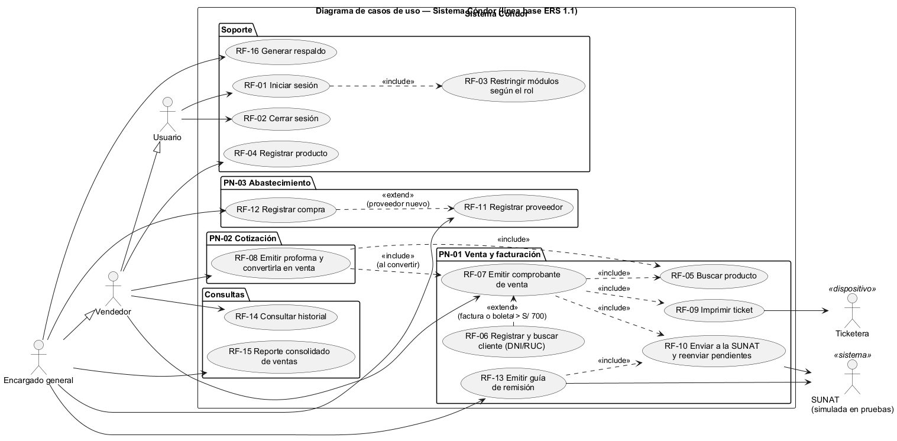

El sistema tiene dos roles de usuario: **Vendedor** y **Encargado general**. El Encargado hereda todos los casos del Vendedor. Hay dos actores externos: la **SUNAT** (simulada en las pruebas, SUP-03) y la **ticketera**.

Los tres procesos de negocio completos son:

| Proceso | Casos de uso | Rol |
|---|---|---|
| PN-01 Venta y facturación electrónica | RF-05 → RF-06 → **RF-07** → RF-09 → RF-10 (y RF-13 para traslados) | Vendedor (RF-13: Encargado) |
| PN-02 Cotización y conversión en venta | **RF-08**, que incluye RF-05 y, al convertir, RF-07 | Vendedor |
| PN-03 Abastecimiento | RF-11 → **RF-12** | Encargado general |

### 4.2 Vista de composición

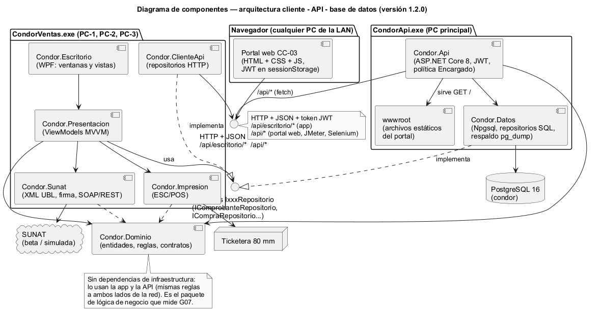

| Componente (proyecto .NET) | Responsabilidad | Depende de | Requisitos que soporta |
|---|---|---|---|
| `Condor.Dominio` | Entidades, reglas de negocio (`EmisionComprobante`, `CalculadoraVenta`, validadores, `ServicioAutenticacion`, `ReporteVentas`) y contratos | Nada (solo .NET) | Todos los CRQ; RF-01, RF-07, RF-08, RF-12, RF-15 |
| `Condor.Presentacion` | ViewModels MVVM: estado de cada pantalla, comandos y mensajes | Dominio | RF-02 a RF-14, RNF-06 |
| `Condor.Escritorio` | Ventanas WPF (XAML), atajos F1–F11 y `AutomationId` estables | Presentación | RNF-06; G09 (Selenium/WinAppDriver) |
| `Condor.ClienteApi` | Implementa los contratos llamando a `/api/escritorio/*`; convierte errores HTTP en excepciones del dominio | Dominio | CC-01, RNF-03 |
| `Condor.Api` | ASP.NET Core 8: autenticación JWT, política `Encargado`, rutas REST, manejo de errores (400/401/403/409/423/503) | Dominio, Datos | RF-01, RF-03, RF-15, RNF-02, RNF-03 |
| `Condor.Datos` | Repositorios SQL con Npgsql, migraciones V001–V014, respaldo con `pg_dump` | Dominio | RNF-04, RNF-07, RF-16 |
| `Condor.Sunat` | XML UBL 2.1, firma digital, `sendBill` / `getStatusCdr`, API de guías, reenvío de pendientes | Dominio | RF-10, RF-13, RNF-05 |
| `Condor.Impresion` | Ticket ESC/POS para la ticketera de 80 mm | Dominio | RF-09 |

### 4.3 Vista lógica

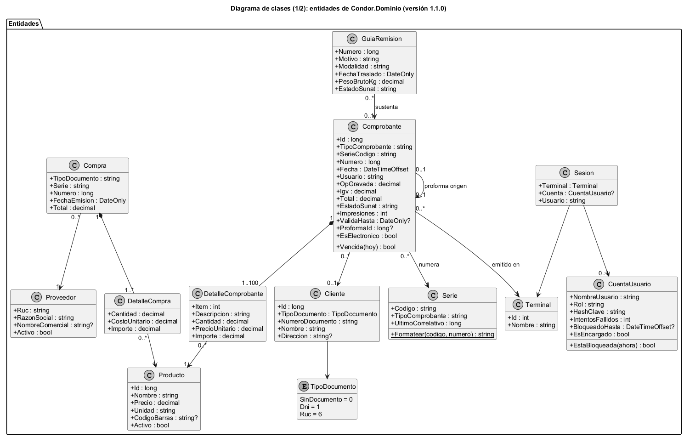

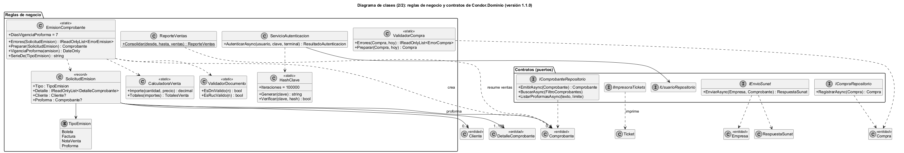

Puntos clave:

- **`Comprobante`** concentra boleta, factura, nota de venta y proforma (`TipoComprobante` = 03, 01, NV, PR). La proforma usa `ValidaHasta`; la venta convertida guarda `ProformaId`.
- **`EmisionComprobante`** es la única puerta de entrada para crear comprobantes. `Errores()` aplica CRQ-02, CRQ-03 y CRQ-14 sin tocar la base; `Preparar()` asigna la serie y calcula importes con `CalculadoraVenta` (CRQ-01).
- **`ServicioAutenticacion`** usa `HashClave` (PBKDF2-SHA256, 100 000 iteraciones) y el contrato `IUsuarioRepositorio`; bloquea al quinto intento (RNF-03).
- **Contratos (puertos):** la aplicación usa `IComprobanteRepositorio` sin saber si detrás está la API (`ComprobanteRepositorioApi`) o PostgreSQL (`ComprobanteRepositorio`). Las pruebas usan repositorios en memoria (DD-04).

### 4.4 Vista de información

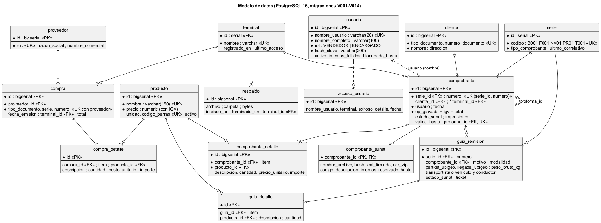

Restricciones que materializan reglas de la ERS en la base de datos:

| Restricción | Regla | Migración |
|---|---|---|
| `UNIQUE (serie_id, numero)` y `UPDATE serie … RETURNING` dentro de la transacción | CRQ-05, RNF-04: sin números repetidos ni saltados | V001, V005 |
| `CHECK (op_gravada + igv = total)` | CRQ-01 | V005 |
| Trigger `ck_factura_con_ruc` | CRQ-03 | V008 |
| `proforma_id` único e trigger `ck_proforma` (solo vigente) | CRQ-06 | V011 |
| `UNIQUE (proveedor_id, tipo_documento, serie, numero)` en `compra` | CRQ-09 | V012 |
| `ck_guia_transporte` | CRQ-13 | V013 |
| `ux_producto_nombre` (único sin distinguir mayúsculas) y `codigo_barras` único; búsqueda sin tildes con `unaccent` y `pg_trgm` | CRQ-08, RNF-01 | V001, V003 |
| `usuario.hash_clave`, `intentos_fallidos`, `bloqueado_hasta` y bitácora `acceso_usuario` | RNF-03, IRQ-08 | V014 |

El detalle de columnas y decisiones está en `docs/modelo_datos.md`, que se actualizó con las tablas de V014 al cerrar CC-01 (G02).

### 4.5 Vista de interacción (proceso crítico)

El proceso crítico es la **emisión de un comprobante** (PN-01, RF-07). Concentra las reglas tributarias, la numeración correlativa compartida entre tres PC, la autoría (CC-01), la impresión y el envío a la SUNAT.

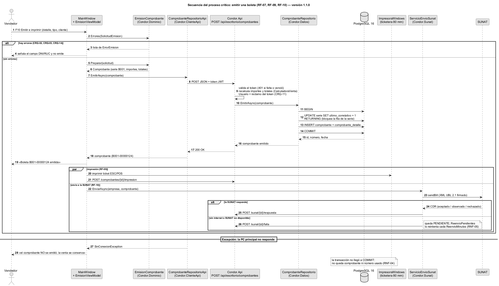

Aspectos de diseño que muestra el diagrama:

1. **Validación en dos capas.** La aplicación valida con el dominio antes de llamar a la red (respuesta inmediata al vendedor). La API vuelve a calcular los totales y toma el usuario del token.
2. **Atomicidad.** El número de serie, la cabecera y el detalle se guardan en una sola transacción. Si algo falla, no queda número usado (RNF-04).
3. **Impresión y envío fuera de la transacción.** Corren en paralelo después de emitir. Una SUNAT caída deja el comprobante PENDIENTE sin frenar la venta (CFL-02, RNF-05).
4. **Excepción sin conexión.** Si la PC principal no responde, el comprobante **no** se emite y la venta queda en pantalla para reintentar.

### 4.6 Vista de estado dinámico

**Ciclo de vida del comprobante electrónico frente a la SUNAT** (RF-10, CRQ-10):

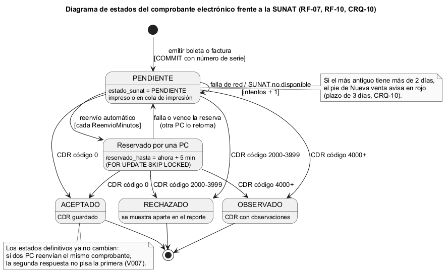

**Flujo del proceso PN-02** (cotización y conversión en venta):

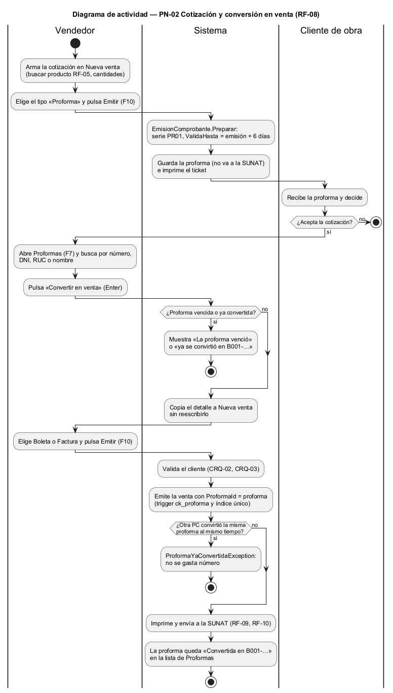

**Flujo del proceso PN-03** (abastecimiento):

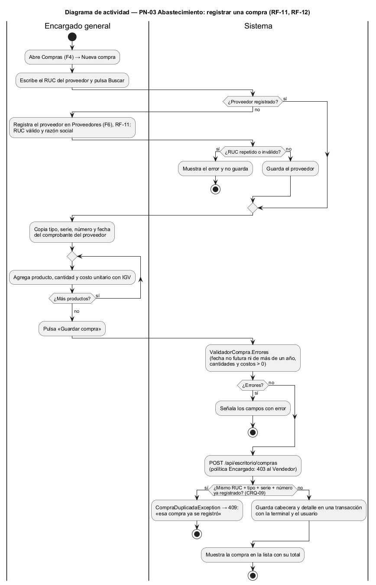

### 4.7 Vista de interfaz

#### 4.7.1 Interfaz HTTP (Condor.Api, puerto 5080)

Todas las rutas, salvo `salud` y `login`, exigen el token JWT (401 sin token). Las marcadas como **E** exigen además el rol Encargado general (403 al Vendedor).

| Método y ruta | Rol | Uso | Requisito | Prueba / guía |
|---|---|---|---|---|
| `GET /api/salud` | — | Disponibilidad de la API y de la base | RNF-07 | G08 (verificación previa) |
| `POST /api/auth/login` | — | Ingreso; devuelve el JWT (480 min); 423 si la cuenta está bloqueada | RF-01, RNF-03 | `ApiTests`; G08 |
| `GET /api/productos?texto=` | V | Buscar productos | RF-05, RNF-01 | G08: consultar productos |
| `POST /api/comprobantes` | V | Emitir; precio y descripción **tomados del catálogo** | RF-07, CRQ-07 | `ApiTests`; G08: emitir boleta |
| `GET /api/comprobantes` | V | Historial por período, tipo o texto | RF-14 | `ApiTests` |
| `GET /api/proveedores` · `POST /api/proveedores` | **E** | Consultar y registrar proveedores | RF-11, CRQ-12 | `ApiTests` (403) |
| `GET /api/reportes/ventas?desde=&hasta=` | **E** | Reporte consolidado por día, tipo, terminal y usuario | RF-15, CRQ-15 | `ApiTests`, `ReporteVentasTests` |
| `GET /api/respaldos` | **E** | Respaldos generados | RF-16 | `ApiTests` |
| `GET /api/proformas` · `POST /api/proformas/{id}/convertir` | V | Proformas con su estado y conversión en venta (CC-03) | RF-08, CRQ-06 | `PortalWebTests`; G09: CP-10 |
| `GET /api/compras` · `POST /api/compras` | **E** | Compras a proveedores con `ValidadorCompra` (CC-03) | RF-12 | `PortalWebTests`; G09: CP-13 |
| `GET /` | — | Portal web del mostrador (archivos estáticos de `wwwroot`, CC-03) | INT-07 | `PortalWebTests`; G09: CP-01 a CP-14 |
| `/api/escritorio/*` (41 rutas) | V / **E** | Contrato interno de la aplicación WPF: catálogo, clientes, comprobantes, proformas, compras (**E**), guías (**E**), envíos SUNAT, respaldos (**E**) | RF-02 a RF-16 | `ClienteApiTests` |

El detalle de cada ruta está en `docs/api.md`.

> **Defecto DEF-01 (revisión OS-07), corregido en 1.1.1.** En la versión 1.1.0, `POST /api/escritorio/comprobantes` conservaba el precio unitario y la descripción enviados por la PC, en contra de CRQ-07. Desde la 1.1.1 (SVN r11) toma los del catálogo, o los de la proforma guardada si la venta sale de una, y valida CRQ-14 en el servidor. Detalle en `04_Revision/revision_SDD.md` y `G05_Gestion_Configuracion`.

#### 4.7.2 Interfaz de usuario (mockups)

Los mockups se diseñaron con los mismos textos, atajos y columnas de la aplicación WPF. Están en `03_Mockups/`.

| Mockup | Pantalla | Casos de uso | Puntos de diseño |
|---|---|---|---|
| 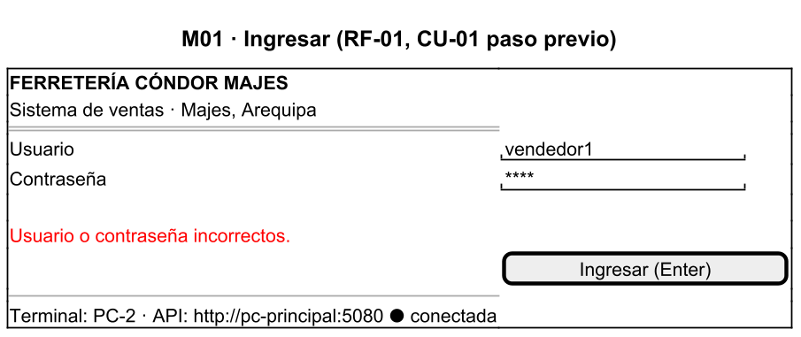 | **M01 Ingresar** | RF-01 | Botón habilitado solo con usuario y clave; el mismo mensaje para usuario inexistente o clave equivocada |
| 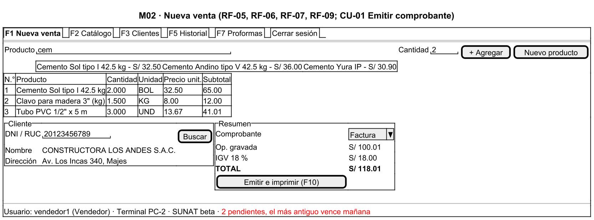 | **M02 Nueva venta** | RF-05, RF-06, RF-07, RF-09 (CU-01) | Todo con teclado (F1–F11, Enter); sugerencias desde la 3.ª letra; resumen siempre visible; pie con usuario, rol y pendientes SUNAT |
| 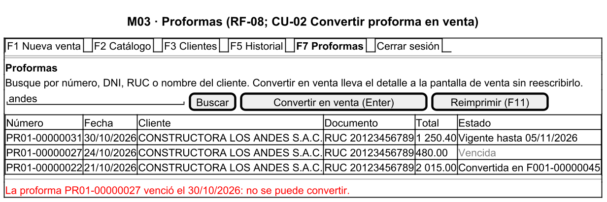 | **M03 Proformas** | RF-08 (CU-02) | Estado Vigente / Vencida / Convertida en cada fila; Enter convierte |
| 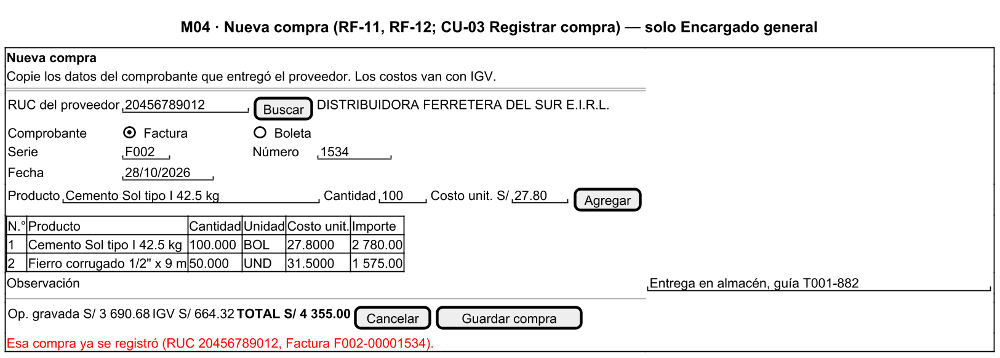 | **M04 Nueva compra** | RF-11, RF-12 (CU-03) | Búsqueda del proveedor por RUC; aviso de compra duplicada |
| 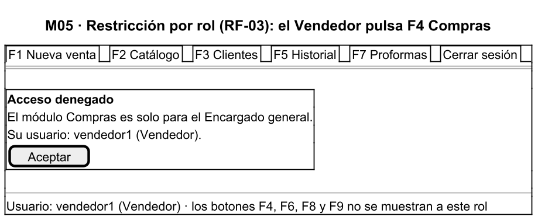 | **M05 Restricción por rol** | RF-03 | El Vendedor no ve F4, F6, F8 ni F9; si pulsa el atajo, ve «Acceso denegado» |

**Portal web (CC-03, versión 1.2.0).** `Condor.Api` sirve en `/` un portal que reproduce M01 a M05 en el navegador, con la misma paleta, los mismos atajos y los mismos `id` que los AutomationId de la app (`CampoUsuario`, `BotonIngresar`, `MenuVenta`…). Las capturas comparativas app/portal están en `G09_Gestion_Calidad/00_Solicitud_Cambio/capturas`.

### 4.8 Vista de despliegue

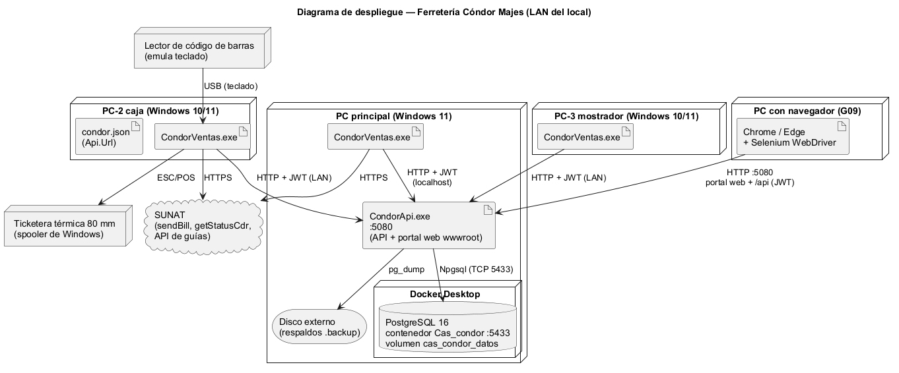

La PC principal aloja la API, PostgreSQL (en Docker, volumen persistente `cas_condor_datos`) y el disco de respaldos. Las otras PC solo tienen `CondorVentas.exe` y su `condor.json` con la URL de la API: **no conocen la clave de la base** (restricción de seguridad de la ERS 2.4). Los registros sobreviven al reinicio de la aplicación, de la API o de la PC (RNF-07).

---

## 5. Especificación de casos de uso

Se especifican los tres casos de uso que sostienen los tres procesos de negocio. Las reglas se citan por su ID de la ERS.

### CU-01 Emitir comprobante de venta (PN-01 · RF-07)

| Campo | Contenido |
|---|---|
| Actor principal | Vendedor (también el Encargado general) |
| Actores secundarios | SUNAT, ticketera |
| Disparador | El cliente decide comprar y el vendedor pulsa **F10 Emitir e imprimir** |
| Precondiciones | 1) Sesión iniciada (RF-01). 2) La PC está registrada en la base central (`Sesion.Registrada`). 3) El detalle tiene al menos un producto (RF-05). |
| Pantalla | M02 Nueva venta |
| Clases y tablas | `EmisionViewModel`, `EmisionComprobante`, `CalculadoraVenta`, `ComprobanteRepositorioApi` → `POST /api/escritorio/comprobantes` → `ComprobanteRepositorio`; tablas `serie`, `comprobante`, `comprobante_detalle`, `comprobante_sunat` |

**Flujo principal**

1. El vendedor agrega productos buscándolos por nombre o con el lector (RF-05) e indica las cantidades.
2. Elige el tipo de comprobante (Boleta por defecto).
3. Pulsa F10. El sistema valida las reglas del comprobante (CRQ-02, CRQ-03, CRQ-14).
4. El sistema prepara el comprobante con la serie del tipo (B001, F001, NV01) y calcula la operación gravada, el IGV y el total (CRQ-01).
5. La API recalcula los totales, toma el usuario del token (CRQ-11) y guarda el comprobante con el siguiente número de la serie en una transacción (CRQ-05).
6. El sistema muestra «Boleta B001-… emitida» y limpia la venta.
7. El sistema imprime el ticket (RF-09) y, si es boleta o factura, lo envía a la SUNAT (RF-10).
8. La SUNAT devuelve el CDR y el comprobante queda ACEPTADO.

**Flujos alternativos**

- **A1 (paso 2) Factura:** el vendedor busca al cliente por RUC (RF-06). Si no existe, lo registra con razón social y dirección y continúa en el paso 3.
- **A2 (paso 2) Boleta de más de S/ 700.00:** el sistema pide el DNI del cliente (CRQ-02). Con el DNI se continúa en el paso 3.
- **A3 (paso 2) Nota de venta:** no exige cliente ni se envía a la SUNAT. En el paso 7 solo se imprime.
- **A4 (paso 7) PC sin ticketera:** se muestra la vista previa del ticket en pantalla.
- **A5 (paso 8) CDR con observaciones:** queda OBSERVADO. Si se rechaza, queda RECHAZADO y se muestra el motivo.

**Excepciones**

- **E1 (paso 3) Datos incompletos o inválidos:** se señala el campo (DNI/RUC, cantidad) y no se emite.
- **E2 (paso 5) La PC principal no responde:** «Sin conexión con la PC principal: el comprobante NO se emitió». La venta queda en pantalla para reintentar y no se usa ningún número.
- **E3 (paso 5) Sesión vencida (401):** se pide ingresar de nuevo. La venta se conserva.
- **E4 (paso 7) Ticketera sin papel:** el comprobante queda emitido con 0 impresiones y se reimprime con F11.
- **E5 (paso 8) Sin internet o SUNAT caída:** el comprobante queda PENDIENTE y el reenvío automático lo reintenta (RNF-05). Si el más antiguo está por vencer el plazo de 3 días, el pie avisa en rojo.

**Postcondiciones**

- **Éxito:** el comprobante queda con serie y número correlativo, usuario y terminal; impreso; y ACEPTADO, OBSERVADO, RECHAZADO o PENDIENTE ante la SUNAT.
- **Fallo:** no queda comprobante ni número usado, y la venta sigue en pantalla.

### CU-02 Convertir una proforma en venta (PN-02 · RF-08)

| Campo | Contenido |
|---|---|
| Actor principal | Vendedor |
| Disparador | El cliente de obra acepta una cotización emitida antes |
| Precondiciones | 1) Sesión iniciada. 2) Existe una proforma PR01 emitida con CU-01 (tipo Proforma), con `ValidaHasta` = emisión + 6 días. |
| Pantalla | M03 Proformas → M02 Nueva venta |
| Clases y tablas | `ProformasViewModel`, `EmisionViewModel` (`ProformaOrigen`), `EmisionComprobante.Preparar` (copia `ProformaId`), `ProformaYaConvertidaException`; `comprobante.proforma_id` (único) y trigger `ck_proforma` |

**Flujo principal**

1. El vendedor abre Proformas (F7) y busca por número, DNI, RUC o nombre.
2. El sistema lista las proformas con su estado (Vigente hasta …, Vencida, Convertida en …).
3. El vendedor selecciona una vigente y pulsa **Convertir en venta** (Enter).
4. El sistema copia el detalle a Nueva venta sin reescribirlo e indica «Venta desde la proforma PR01-…».
5. El vendedor elige Boleta o Factura y pulsa F10. Continúa CU-01 desde el paso 3.
6. El sistema guarda la venta con `ProformaId`. La proforma aparece como «Convertida en B001-…».

**Flujos alternativos**

- **A1 (paso 3) Reimprimir:** el vendedor pulsa F11 y el sistema reimprime la proforma marcada como copia.
- **A2 (paso 5) Factura a cliente con RUC:** el cliente de la proforma se lleva a la venta. Si no tiene RUC, se aplica CU-01 A1.

**Excepciones**

- **E1 (paso 3) Proforma vencida** (hoy > `ValidaHasta`): «La proforma venció el …», y no se convierte (CRQ-06).
- **E2 (paso 3) Proforma ya convertida:** se muestra el comprobante en que terminó y no se convierte otra vez.
- **E3 (paso 6) Otra PC convirtió la misma proforma al mismo tiempo:** el índice único rechaza la segunda conversión (`ProformaYaConvertidaException`) y no se gasta número.

**Postcondiciones**

- **Éxito:** existe una venta enlazada a la proforma, y la proforma queda convertida una sola vez. Las proformas no suman en el total de ventas (CRQ-15).
- **Fallo:** la proforma sigue vigente y sin convertir.

### CU-03 Registrar compra a proveedor (PN-03 · RF-12)

| Campo | Contenido |
|---|---|
| Actor principal | Encargado general |
| Disparador | Llega mercadería con el comprobante del proveedor |
| Precondiciones | 1) Sesión iniciada con rol Encargado general (RF-03). 2) Los productos existen en el catálogo (RF-04). |
| Pantalla | M04 Nueva compra (desde Compras, F4) |
| Clases y tablas | `NuevaCompraViewModel`, `ValidadorCompra.Errores/Preparar`, `CompraRepositorioApi` → `POST /api/escritorio/compras` (política Encargado) → `CompraRepositorio`; tablas `proveedor`, `compra`, `compra_detalle` |

**Flujo principal**

1. El encargado abre Compras (F4) → Nueva compra.
2. Escribe el RUC del proveedor y pulsa Buscar. El sistema muestra la razón social.
3. Elige el tipo (Factura o Boleta) e ingresa la serie, el número y la fecha del comprobante.
4. Agrega cada producto con su cantidad y su costo unitario con IGV. El sistema calcula los importes y totales.
5. Pulsa **Guardar compra**. El sistema valida con `ValidadorCompra`.
6. La API guarda la cabecera y el detalle en una transacción, con la terminal y el usuario.
7. La compra aparece en la lista de Compras con su total.

**Flujos alternativos**

- **A1 (paso 2) Proveedor no registrado:** el encargado lo registra en Proveedores (F6, RF-11) con un RUC válido y vuelve al paso 2.
- **A2 (paso 4) Costo con más de dos decimales:** se admiten hasta 4 decimales en el costo unitario (compras por millar).

**Excepciones**

- **E1 (paso 5) Fecha futura o de más de un año, o cantidad/costo ≤ 0:** se señala el campo y no se guarda.
- **E2 (paso 6) Comprobante del proveedor ya registrado** (mismo RUC, tipo, serie y número, CRQ-09): la API responde 409 y se muestra «Esa compra ya se registró».
- **E3 (paso 1) Usuario Vendedor:** el módulo no se muestra y la API responde 403 aunque se llame directamente (CRQ-12, M05).
- **E4 (paso 6) Sin conexión:** «Sin conexión con la PC principal. La compra NO se guardó y sus datos se conservan: pulse Guardar para reintentar.»

**Postcondiciones**

- **Éxito:** la compra queda registrada una sola vez, con su detalle, terminal y usuario.
- **Fallo:** no queda ninguna parte de la compra.

---

## 6. Decisiones de diseño

| ID | Decisión | Alternativas consideradas | Justificación | Requisitos |
|---|---|---|---|---|
| DD-01 | Las reglas de negocio están en `Condor.Dominio`, sin dependencias de infraestructura, y se usan en la aplicación **y** en la API | Reglas en procedimientos almacenados; reglas solo en la API | Una regla se cambia en un solo lugar; respuesta inmediata en la PC; pruebas unitarias sin base de datos (meta de cobertura de G07) | CRQ-01 a CRQ-15, RNF-08 |
| DD-02 | Arquitectura **cliente – API – base**: la aplicación ya no se conecta a PostgreSQL (CC-01) | Cliente pesado contra la base (versión 1.0.0) | La clave de la base deja las PC; los roles se aplican en el servidor; rutas HTTP para JMeter | RF-03, RNF-02, RNF-03, CRQ-12 |
| DD-03 | Correlativo con `UPDATE serie … RETURNING` dentro de la transacción de emisión, más `UNIQUE (serie_id, numero)` | Secuencias de PostgreSQL; numeración en cada PC | Las secuencias dejan huecos cuando una transacción falla; el bloqueo de fila garantiza 0 repetidos y 0 saltados con 3 PC | CRQ-05, RNF-04 |
| DD-04 | Puertos (contratos) e implementaciones intercambiables: `…RepositorioApi`, `…Repositorio` (SQL) y repositorios en memoria para las pruebas | Acceso directo a la base desde los ViewModels | Permite probar los ViewModels y las reglas con dobles de prueba y cambiar a la API sin tocar la presentación | RNF-08, G07 |
| DD-05 | El envío a la SUNAT ocurre **después** de emitir y fuera de la transacción; los pendientes se reenvían con reserva `FOR UPDATE SKIP LOCKED` | Enviar dentro de la emisión y esperar el CDR | La venta no depende de internet; dos PC no envían el mismo comprobante | RF-10, RNF-05, CFL-02 |
| DD-06 | La proforma vive en `comprobante` (serie PR01) y la venta guarda `proforma_id` único | Tabla aparte de proformas | La conversión copia el detalle sin reescribirlo; la unicidad impide la doble conversión concurrente | RF-08, CRQ-06 |
| DD-07 | Autenticación con JWT de 480 minutos y contraseña con PBKDF2-SHA256 (100 000 iteraciones, sal de 16 bytes) | Sesión por cookie; bcrypt | El token dura un turno (CFL-01); PBKDF2 viene en .NET sin dependencias externas | RF-01, RNF-03 |
| DD-08 | Interfaz con atajos F1–F11 y `AutomationId` estables | Navegación solo con el mouse | Venta solo con teclado (RNF-06); selectores estables para la automatización de G09 | RNF-06, G09 |
| DD-09 | Portal web estático (HTML, CSS y JavaScript sin dependencias) servido por `Condor.Api`, sobre las mismas rutas `/api` (CC-03) | Automatizar la app WPF con Appium y WinAppDriver; un frontend con framework (React, Blazor) | Selenium WebDriver necesita un navegador; WinAppDriver no se mantiene desde 2020. Sin framework no hay compilación ni dependencias nuevas, y al no tener reglas propias el portal no duplica `Condor.Dominio` | INT-07, RF-03, G09 |

---

## 7. Trazabilidad: requisito → diseño → código → prueba

Los nombres son los mismos en la ERS, en este SDD, en el código y en la base de datos.

| Requisito | Caso / proceso | Clases principales (código) | Tablas | Pantalla | Pruebas |
|---|---|---|---|---|---|
| RF-01 | Soporte | `ServicioAutenticacion`, `HashClave`, `LoginViewModel`, `AutenticadorApi` | `usuario`, `acceso_usuario` | M01 | `ServicioAutenticacionTests`, `LoginViewModelTests`, `ApiTests` |
| RF-02 | Soporte | `MainViewModel` (Cerrar sesión) | — | M02 (menú) | `CC01_IngresoConRolesTests` |
| RF-03 | Soporte | `Roles`, `PermisosModulo`, política `Encargado` | `usuario.rol` | M05 | `CC01_IngresoConRolesTests`, `ApiTests` |
| RF-04 | Soporte | `ValidadorProducto`, `NuevoProductoViewModel`, `ProductoRepositorio` | `producto` | — | `HU01_…`, `ValidadorProductoTests` |
| RF-05 | PN-01 | `BuscadorProductoViewModel`, `IConsultaProductos` | `producto` (índice trigram) | M02 | `HU02_…`, `HU13_…` |
| RF-06 | PN-01 | `ValidadorDocumento`, `ClienteVentaViewModel` | `cliente` | M02 | `HU03_…`, `ValidadorDocumentoTests` |
| **RF-07** | **CU-01** | `EmisionComprobante`, `CalculadoraVenta`, `EmisionViewModel`, `ComprobanteRepositorio` | `serie`, `comprobante`, `comprobante_detalle` | M02 | `HU05_…`, `HU06_…`, `HU08_…`, `EmisionComprobanteTests` |
| **RF-08** | **CU-02** | `ProformasViewModel`, `EmisionComprobante` | `comprobante.proforma_id` | M03 | `HU09_ProformasTests`, `ConversionProformaTests` |
| RF-09 | PN-01 | `FormatoTicket`, `MontoEnLetras`, `ImpresoraWindows` | `comprobante.impresiones` | M02 | `HU12_…`, `FormatoTicketTests` |
| RF-10 | PN-01 | `ServicioEnvioSunat`, `ReenvioPendientes`, `EnvioSunatViewModel` | `comprobante_sunat` | M02 (pie) | `HU07_…`, `HU17_…` |
| RF-11 | PN-03 | `ValidadorProveedor`, `NuevoProveedorViewModel` | `proveedor` | M04 (A1) | `HU04_…`, `ValidadorProveedorTests` |
| **RF-12** | **CU-03** | `ValidadorCompra`, `NuevaCompraViewModel`, `CompraRepositorio` | `compra`, `compra_detalle` | M04 | `HU11_ComprasTests`, `ValidadorCompraTests` |
| RF-13 | PN-01 | `ValidadorGuia`, `ServicioGuiaSunat`, `GuiasViewModel` | `guia_remision`, `guia_detalle` | — | `HU10_…`, `ValidadorGuiaTests` |
| RF-14 | Consultas | `ComprobanteRepositorio.BuscarAsync` | `comprobante` | — | `HU18_HistorialTests` |
| RF-15 | Consultas | `ReporteVentas`, `ReporteVentasRepositorio`, `GET /api/reportes/ventas` | `comprobante` | — (API) | `ReporteVentasTests`, `ApiTests` |
| RF-16 | Soporte | `ServicioRespaldo`, `RespaldoViewModel` | `respaldo` | — | `HU15_RespaldoTests` |
| RNF-01 a RNF-08 | Transversal | Ver ERS, sección 4; diseño en DD-01 a DD-08 | — | — | G07, G08, G09 |

---

## 8. Utilidad de los diagramas UML en este proyecto

| Diagrama | Tipo UML | ¿Qué pregunta responde en Cóndor? | Quién lo usa | Utilidad | Archivo |
|---|---|---|---|---|---|
| Casos de uso | Comportamiento | ¿Qué hace cada rol y qué servicios externos intervienen? | Gerente, docente, G09 (casos Selenium) | **Alta**: valida el alcance y los dos roles | `01_casos_uso` |
| Clases (entidades) | Estructura | ¿Qué datos maneja el dominio y cómo se relacionan? | Desarrolladores, G07 (unidades a probar) | **Alta** | `02a_clases_entidades` |
| Clases (reglas y contratos) | Estructura | ¿Dónde está cada regla y qué se puede reemplazar por un doble de prueba? | Desarrolladores, G07 | **Alta**: guía el aislamiento con dobles | `02b_clases_reglas` |
| Secuencia: emitir | Interacción | ¿Qué pasa, y en qué orden, cuando se emite? ¿Dónde puede fallar? | Desarrolladores, G06 (riesgos), G08 (transacción a medir) | **Muy alta**: proceso crítico con concurrencia, red y SUNAT | `03_secuencia_emitir_comprobante` |
| Estados del comprobante | Comportamiento | ¿Qué estados ante la SUNAT existen y qué los cambia? | Contador, G07 (casos límite) | **Alta** | `04_estados_comprobante` |
| Actividad PN-02 y PN-03 | Comportamiento | ¿Cuál es el flujo completo de cotización y de compra, con sus decisiones? | Gerente, encargado, G09 | **Media**: complementa los casos de uso | `05_…`, `06_…` |
| Componentes | Estructura | ¿Qué proyecto hace qué y quién depende de quién? | Desarrolladores, G05 (elementos de configuración) | **Alta** tras CC-01 | `07_componentes` |
| Despliegue | Estructura | ¿Qué corre en cada PC y por dónde viajan los datos? | Encargado, G06 (activos), G08 (entorno) | **Alta** | `08_despliegue` |
| Entidad–relación | (Modelado de datos, no UML) | ¿Qué tablas, claves y restricciones protegen las reglas? | Desarrolladores, G06 (respaldo) | **Alta** | `09_modelo_datos` |

No se elaboraron diagramas de objetos, de comunicación, de tiempos ni de paquetes: la información que darían ya está en los diagramas de clases, de secuencia y de componentes.

---

## 9. Cambios de diseño por solicitudes de cambio

| Cambio | Impacto en el diseño | Estado |
|---|---|---|
| CC-01 Ingreso con roles y backend REST (G02) | DD-02 y DD-07; componentes `Condor.Api` y `Condor.ClienteApi`; tablas `usuario` y `acceso_usuario`; M01 y M05; `comprobante.usuario` real | Implementado en 1.1.0 y reflejado en todas las vistas de este SDD |
| CC-02 Descuento del vendedor (G02) | Ninguno (rechazado) | — |
| CC-03 Portal web del mostrador (G09) | DD-09; componente «Portal web» y `wwwroot` en `Condor.Api`; nodo «PC con navegador» en el despliegue; rutas de proformas y compras en 4.7.1 | Implementado en 1.2.0 (SVN r28–r32) |
