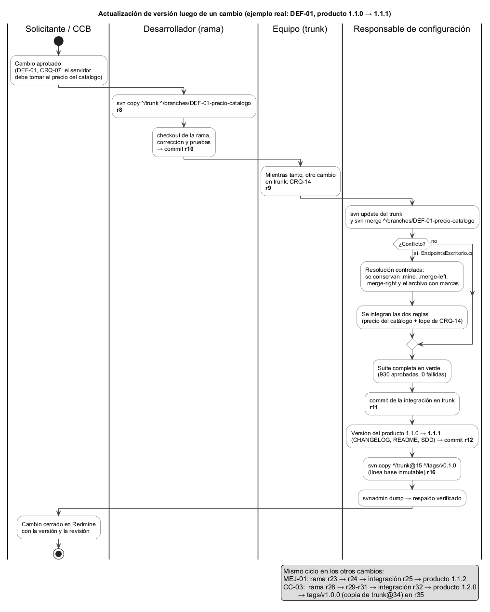

# Cuestionario de la guía PRAC05, aplicado al producto

## a) ¿Hasta qué nivel de recuperación de versiones pasadas se puede llegar?

**Hasta cualquier revisión desde la r0 y con cualquier granularidad**: el repositorio completo, una carpeta, un archivo o una sola línea de código. SVN guarda cada commit como una revisión inmutable del árbol entero, y en Cóndor nunca se borró historia: el repositorio va de r0 a r35.

| Nivel | Comando | Evidencia en Cóndor |
|---|---|---|
| **Producto completo** en una revisión anterior | `svn export -r 2 ^/trunk/Sistema_Logistico_Condor_final producto_r2` | Se recuperó el producto 1.1.0 de r2 (327 archivos) en otra carpeta, sin tocar el trunk, y se compiló y probó (`04_Evidencias/recuperacion/01_recuperar_revision_r2.txt`, `reconstruccion_producto_r2.trx`) |
| **Archivo eliminado**, con su historia | `svn copy ^/trunk/<ruta>@12 ^/trunk/<ruta>` | `docs/api.md`, borrado en r13, se restauró en r14 con su historial hasta r2 y el mismo MD5 que en r12 (`02_restaurar_archivo_eliminado.txt`) |
| **Cambio puntual** | `svn diff -r 2:12 <archivo>`; deshacer con `svn merge -c -N` | Diferencia de `EndpointsEscritorio.cs` entre 1.1.0 y 1.1.1 |
| **Línea base** | `svn checkout ^/tags/v0.1.0`, `^/tags/v0.2.0` o `^/tags/v1.0.1` | Etiquetas de avance 1 (r16), avance 2 (r41) y entrega final (r35, corregida en r44) |
| **Repositorio entero** ante la pérdida del servidor | `svnadmin load` desde el dump | `03_Respaldo/condor_r44.dump.gz`, cargado en un repositorio vacío: r0–r44, 4 007 archivos idénticos en trunk y en `tags/v1.0.1`, `svnadmin verify` sin errores (`04_respaldo_y_verificacion.txt`) |

Hay dos límites. Solo se recupera lo que se confirmó: un cambio que quedó en la copia de trabajo sin `commit` no existe para SVN. Y sin el respaldo, la pérdida del disco del servidor se llevaría toda la historia; por eso la política exige un `svnadmin dump` verificado en cada etiqueta (procedimiento 6).

## b) ¿Cuál es la estructura del nombre o etiqueta propuesta para cada versión?

La define la sección 5 de `01_Politica/politica_configuracion.md`. Hay **dos numeraciones independientes**:

| Elemento | Estructura | Ejemplos reales |
|---|---|---|
| **Etiqueta de entrega del trabajo** | `tags/vMAYOR.MENOR.PARCHE` (SemVer) | `tags/v0.1.0` = avance 1 (r16) · `tags/v0.2.0` = avance 2 (r41) · `tags/v1.0.0` = entrega final (r35) · `tags/v1.0.1` = entrega final corregida (r44) |
| **Versión del producto** | `MAYOR.MENOR.PARCHE` en `CHANGELOG.md` y en `<Version>` de los `.csproj` | 1.1.0 (CC-01) · 1.1.1 (DEF-01) · 1.1.2 (MEJ-01) · 1.2.0 (CC-03) |
| **Rama** | `branches/<ID>-<descripción-corta>` | `DEF-01-precio-catalogo`, `MEJ-01-correlativo-al-final`, `CC-03-portal-web` |
| **Mensaje de commit** | `<ID>: <qué cambia y por qué>` | `DEF-01: el servidor toma el precio del catálogo (CRQ-07)` |

Reglas de SemVer en el producto: **MENOR** sube con una función nueva compatible (CC-01, CC-03) y **PARCHE** con una corrección o mejora sin funciones nuevas (DEF-01, MEJ-01). **MAYOR** subiría con un cambio incompatible, por ejemplo una API que rompa la app de escritorio.

La entrega final `tags/v1.0.0` contiene el producto **1.2.0**. La etiqueta numera la entrega y la versión numera el software; el manifiesto (sección 8 de la política) registra qué versión del producto contiene cada etiqueta. Las etiquetas son inmutables: authz solo deja crearlas al responsable de configuración y rechaza cualquier modificación posterior (`04_Evidencias/05_etiqueta_v1.0.0.txt`).

## c) Diagrama de actualización de versión luego de un cambio

Fuente editable: `07_diagrama_actualizacion_version.puml`. Exportaciones: `.svg` y `.png`.

El diagrama usa las revisiones reales de DEF-01:

1. El cambio aprobado se desarrolla en una **rama** (r8) para no afectar la línea principal, y se corrige en ella (r10).
2. Mientras tanto, el trunk avanza con otro cambio, CRQ-14 (r9).
3. El responsable de configuración **actualiza** el trunk y **fusiona** la rama. El conflicto en `EndpointsEscritorio.cs` se resuelve conservando las dos reglas y guardando los archivos del conflicto como evidencia.
4. Con la suite en verde se **confirma** la integración (r11) y sube la **versión del producto** a 1.1.1 (r12).
5. Se crea la **etiqueta** inmutable (r16) y se genera el **respaldo** verificado.
6. El cambio se **cierra** en Redmine con la versión y la revisión.

MEJ-01 (r23–r25, producto 1.1.2) y CC-03 (r28–r32, producto 1.2.0, etiqueta `v1.0.0` en r35) siguieron el mismo ciclo.
