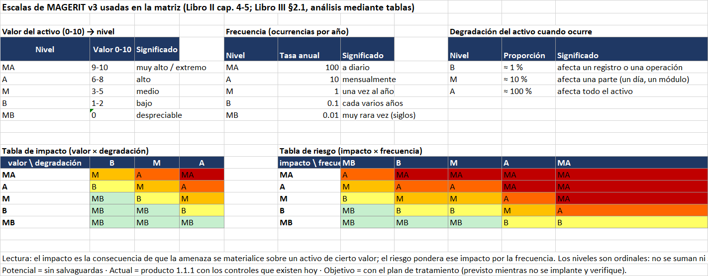
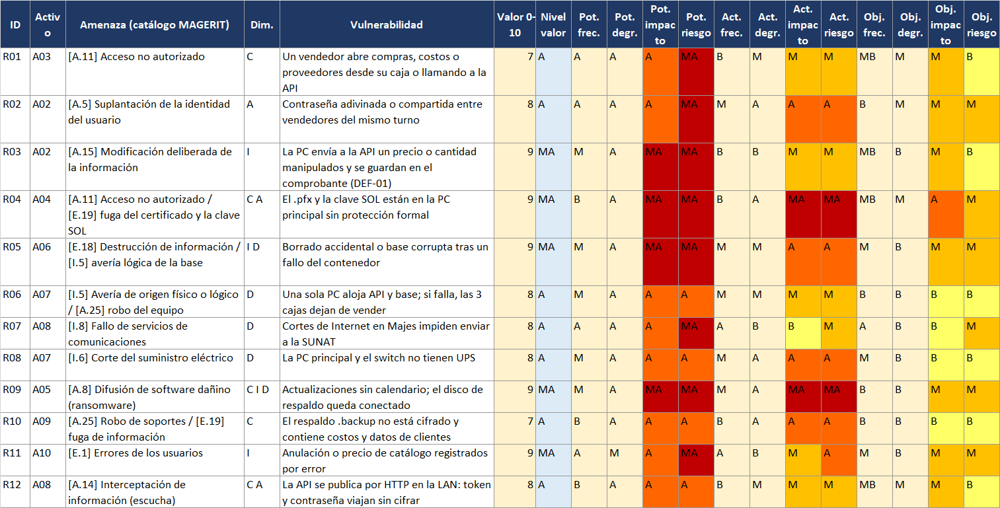
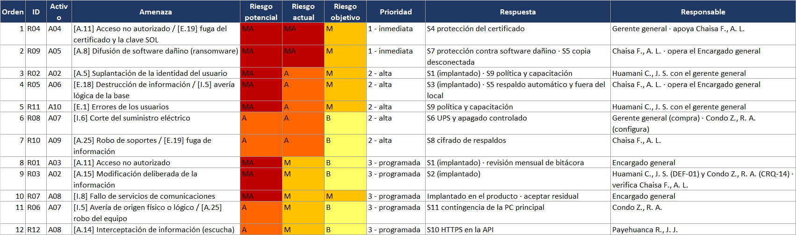
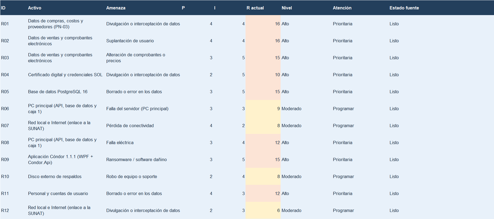
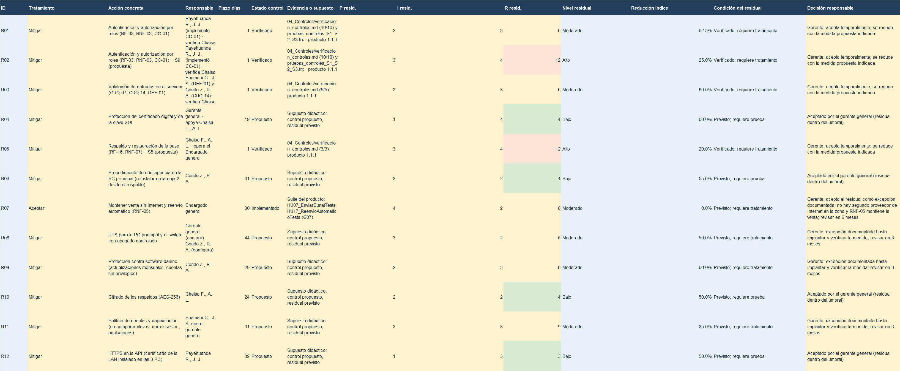

# Matriz de riesgos — MAGERIT v3 (G06)

| Campo | Valor |
|---|---|
| Sistema | Sistema de Ventas y Facturación Cóndor 1.1.1 — Ferretería Cóndor Majes S.A.C. |
| Activos | A01 a A10 (`01_Inventario/inventario_activos.md`) |
| Libro editable | `matriz_riesgos_magerit.xlsx` (hojas Escalas, Valor acumulado, Escenarios, Priorización, Plan de tratamiento, PILAR) |
| Complemento P × I | `Plan_Riesgo_Condor.xlsx` (plantilla docente de la práctica 6 completada) |
| Generador | `python generar_matrices.py` (los dos libros salen de los mismos datos) |
| Responsable | Integrante 4 — Chaisa Fernández, Anthony Leonel · revisó: Integrante 2 · validó: gerente general (representado) |
| Fecha | 2026-11-01 |

## 1. Método y escalas

La matriz aplica el **análisis mediante tablas de MAGERIT v3** (Libro III, §2.1): para cada escenario activo–amenaza se estima la **frecuencia** con que se materializa la amenaza y la **degradación** que causa en el activo; con el **valor** del activo se obtiene el **impacto** y, con la frecuencia, el **riesgo**. En el libro, impacto y riesgo se calculan con fórmulas `INDEX/MATCH` sobre las tablas de la hoja *Escalas*; solo frecuencia y degradación son entradas.

| Magnitud | Escala | Fuente |
|---|---|---|
| Valor del activo | 0–10 de MAGERIT, reducida a 5 niveles: MA (9–10), A (6–8), M (3–5), B (1–2), MB (0) | Libro II, cap. 4 · valoración de A.2 en PILAR |
| Frecuencia | MA = 100/año (a diario) · A = 10/año (mensual) · M = 1/año · B = 0,1/año (cada varios años) · MB = 0,01/año | Libro II, cap. 5; Libro III §2.1 |
| Degradación | B ≈ 1 % (un registro u operación) · M ≈ 10 % (una parte: un día, un módulo) · A ≈ 100 % (todo el activo) | Libro III §2.1 |
| Impacto | Tabla valor × degradación | Libro III §2.1.1 |
| Riesgo | Tabla impacto × frecuencia | Libro III §2.1.2 |

Se evalúan tres situaciones, las mismas fases que usa PILAR:

- **Potencial**: sin salvaguardas.
- **Actual**: producto 1.1.1 con los controles que existen hoy (incluidos S1, S2 y S3).
- **Objetivo**: con el plan de tratamiento. Es un riesgo **previsto** mientras el control no se implante y se verifique.

El valor de un activo de soporte es el **valor acumulado** de los activos esenciales que dependen de él (hoja *Valor acumulado*), igual que en PILAR. En un escenario con varias dimensiones se toma la de mayor valor.

## 2. Información utilizada

| Dato | De dónde sale |
|---|---|
| Frecuencias de uso, horas punta, cortes de luz e Internet, préstamo de claves | Entrevista ENT-01, cuestionario CUE-01 y observación OBS-01 (G01) |
| Valor de los activos | Valoración del gerente (A.2 de PILAR) y requisitos CRQ-01, CRQ-05, CRQ-11, CRQ-12, CFL-06 |
| Arquitectura y dependencias | SDD de G03: una PC aloja API y base; las cajas llegan por la LAN; la API se publica por HTTP |
| Defecto real | DEF-01 (precio aceptado desde la PC), corregido en 1.1.1 (G05) |
| Eficacia de S1, S2 y S3 | Prueba de funcionamiento contra el sistema en ejecución (`04_Controles`, 18/18) |
| Madurez de las demás salvaguardas | A.5.1 de PILAR (`03_PILAR/capturas/06_pilar_A51_salvaguardas.png`) |

Las frecuencias son **estimaciones del equipo con esos datos**, no estadísticas históricas: la ferretería no lleva un registro de incidentes. Por eso se usan niveles y no tasas exactas.

## 3. Escenarios activo–amenaza (12)

| ID | Activo | Amenaza (MAGERIT) | Dim. | Valor | Potencial f / d → I → **R** | Actual f / d → I → **R** | Objetivo f / d → I → **R** |
|---|---|---|---|---|---|---|---|
| R01 | A03 Compras y costos | [A.11] Acceso no autorizado | C | 7 | A / A → A → **MA** | B / M → M → **M** | MB / M → M → **B** |
| R02 | A02 Datos de ventas | [A.5] Suplantación de la identidad | A | 8 | A / A → A → **MA** | M / A → A → **A** | B / M → M → **M** |
| R03 | A02 Datos de ventas | [A.15] Modificación deliberada de la información | I | 9 | M / A → MA → **MA** | B / B → M → **M** | MB / B → M → **B** |
| R04 | A04 Certificado y clave SOL | [A.11] / [E.19] Fuga del certificado | C A | 9 | B / A → MA → **MA** | B / A → MA → **MA** | MB / M → A → **M** |
| R05 | A06 Base de datos | [E.18] Destrucción / [I.5] avería lógica | I D | 9 | M / A → MA → **MA** | M / M → A → **A** | M / B → M → **M** |
| R06 | A07 PC principal | [I.5] Avería / [A.25] robo del equipo | D | 8 | M / A → A → **A** | M / M → M → **M** | B / B → B → **B** |
| R07 | A08 Red e Internet | [I.8] Fallo de comunicaciones | D | 8 | A / A → A → **MA** | A / B → B → **M** | A / B → B → **M** |
| R08 | A07 PC principal | [I.6] Corte del suministro eléctrico | D | 8 | M / A → A → **A** | M / A → A → **A** | M / B → B → **B** |
| R09 | A05 Aplicación | [A.8] Software dañino (ransomware) | C I D | 9 | M / A → MA → **MA** | M / A → MA → **MA** | B / B → M → **M** |
| R10 | A09 Disco de respaldos | [A.25] Robo de soportes / [E.19] fuga | C | 7 | B / A → A → **A** | B / A → A → **A** | B / B → B → **B** |
| R11 | A10 Personal y cuentas | [E.1] Errores de los usuarios | I | 9 | A / M → A → **MA** | A / B → M → **A** | M / B → M → **M** |
| R12 | A08 Red local | [A.14] Interceptación (HTTP sin cifrar) | C A | 8 | B / A → A → **A** | B / M → M → **M** | MB / M → M → **B** |

f = frecuencia · d = degradación · I = impacto · R = riesgo. La vulnerabilidad, los controles actuales y la justificación de cada estimación están en la hoja *Escenarios*.

**Por qué baja el riesgo actual en R01, R02, R03 y R05.** No es una suposición: S1, S2 y S3 se probaron contra el sistema en ejecución. En R01 un vendedor ya no puede leer costos (6 de 6 rutas responden 403); quedaría el caso de una clave del encargado robada, menos frecuente (B) y con exposición parcial (M). En R03 la API descarta el precio enviado por la PC: un intento de manipulación afecta, como mucho, una línea rechazada (B). En R05 la restauración se comprobó con conteos idénticos, pero el respaldo es manual y se perdería lo emitido desde el último (M). En R02 el bloqueo impide adivinar la clave, pero no evita que un vendedor preste la suya: por eso el riesgo sigue alto.

## 4. Priorización

Orden: riesgo actual y, a igualdad, riesgo potencial.

| Prioridad | Riesgos | Respuesta |
|---|---|---|
| **1 — inmediata** (actual MA) | R04 certificado · R09 ransomware | S4 · S7 + S5 |
| **2 — alta** (actual A) | R02 suplantación · R05 destrucción de la base · R11 errores · R08 corte eléctrico · R10 robo del disco | S9 · S5 · S9 · S6 · S8 |
| **3 — programada** (actual M) | R01 · R03 · R07 · R06 · R12 | revisión de bitácora · S2 vigente · aceptar · S11 · S10 |

Cada riesgo tiene responsable y respuesta en `plan_tratamiento.md`. Ningún riesgo queda sin tratar: R07 se **acepta** con un control ya implantado (venta sin Internet) porque no hay un segundo proveedor de Internet en la zona.

## 5. Relación con PILAR

PILAR Basic 2026.1.1 trabaja con el mismo modelo (activos, dependencias, valor, amenazas del catálogo, salvaguardas con madurez actual y objetivo), pero **valora las amenazas de forma automática** con la biblioteca `BASIC_es` (perfil `tsv_last.xlsx`) y presenta el riesgo **acumulado por activo esencial y dimensión** en una escala 0–10. No muestra el detalle por amenaza en la edición de evaluación, y la exportación a CSV, HTML y el mapa de riesgos están bloqueados por la licencia `test` (`03_PILAR/capturas/12_pilar_mapa_riesgos_modo_evaluacion.png`).

Riesgo acumulado de PILAR (A.6, `03_PILAR/capturas/07` a `10`):

| Activo | Dim. | Potencial | Actual (current) | Objetivo (target) | Recomendación PILAR |
|---|---|---|---|---|---|
| A01 Servicio de venta | [D] | 6,0 | 5,7 | 3,9 | 3,0 |
| A02 Datos de ventas | [I] | 6,9 | 6,7 | 4,3 | 3,9 |
| A02 Datos de ventas | [A] | 6,5 | 5,9 | 3,9 | 3,5 |
| A02 Datos de ventas | [C] | 5,1 | 3,7 | 2,1 | 2,1 |
| A03 Compras y costos | [C] | 6,3 | 4,9 | 3,2 | 3,3 |

Leyenda de PILAR: 3 alto · 4 muy alto · 5 crítico · 6 muy crítico.

**Contraste.** Las dos herramientas coinciden en lo esencial:

- La dimensión más expuesta es la **integridad de los datos de ventas** (PILAR 6,7 actual; en la matriz, R03, R05 y R11 sobre [I] parten de MA).
- La **confidencialidad de los costos** es la que más baja con lo implantado (PILAR 6,3 → 4,9; matriz R01 MA → M), por S1.
- En la **disponibilidad del servicio** casi no hay reducción actual (PILAR 6,0 → 5,7; matriz R06 y R08 siguen en M y A): faltan UPS y contingencia (S6, S11).
- El objetivo deja todo en niveles 2–4 en PILAR y en M o B en la matriz.

La matriz añade lo que PILAR Basic no muestra: el escenario concreto, su justificación y el vínculo con el control verificado.

## 6. Matriz simplificada P × I (complemento)

`Plan_Riesgo_Condor.xlsx` es la plantilla docente de la práctica 6 completada con el mismo caso. Es un **complemento** del análisis MAGERIT, no su implementación: P × I con escala 1–5 y umbral de aceptación R ≤ 4.

Correspondencia usada: P = nivel de frecuencia (MB = 1 … MA = 5), I = nivel de impacto MAGERIT (MB = 1 … MA = 5). La evaluación “actual” de la plantilla toma, para R01, R02, R03 y R05, la **línea base 1.0.0** (antes de CC-01 y DEF-01), porque S1, S2 y S3 son justamente los tratamientos implantados y verificados. Su residual es el riesgo actual de la matriz MAGERIT, con estado *Verificado* y la evidencia. Los demás escenarios tienen residual *previsto*.

| Resultado de la plantilla | Riesgos |
|---|---|
| Residual verificado dentro del umbral | — |
| Residual verificado sobre el umbral (requiere la medida adicional) | R01 (6), R03 (6), R02 (12), R05 (12) |
| Residual previsto ≤ 4 (requiere prueba) | R04, R06, R10, R12 |
| Residual previsto > 4 (excepción documentada por el gerente) | R08, R09, R11, R07 (aceptado) |

## 7. Limitaciones

- Las frecuencias son juicio experto con datos de G01, no estadística; un registro de incidentes durante 12 meses permitiría recalibrarlas.
- Las tablas de 5 niveles son gruesas: un mismo nivel agrupa situaciones distintas (por ejemplo, R01 y R12 en M).
- Los valores de PILAR se transcriben de las capturas porque la licencia de evaluación no permite exportarlos.
- La matriz P × I es ordinal: la “reducción del índice” no es una probabilidad ni un ahorro en soles.
