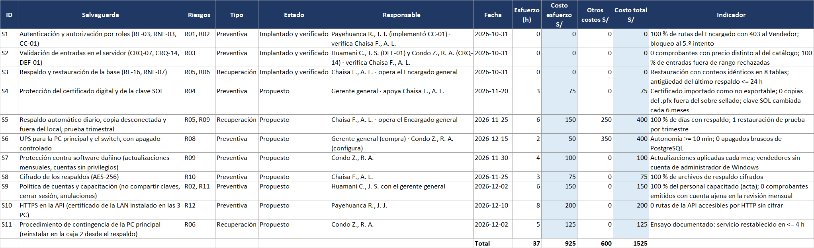

# Plan de tratamiento de riesgos (G06)

Sistema Cóndor 1.1.1 · fecha 2026-11-01 · tarifa de referencia **S/ 25,00 por hora** (la misma de G02 y G04) · hoja *Plan de tratamiento* de `matriz_riesgos_magerit.xlsx`, donde los costos se calculan con fórmula.

## 1. Salvaguardas

**Implantado y verificado** = existe en el producto y se comprobó en esta guía con una prueba de funcionamiento. **Propuesto** = todavía no existe; su riesgo residual es previsto.

| ID | Salvaguarda | Riesgos | Tipo | Estado | Responsable | Fecha | Esfuerzo | Costo S/ | Indicador |
|---|---|---|---|---|---|---|---|---|---|
| S1 | Autenticación y autorización por roles (RF-03, RNF-03, CC-01): PBKDF2 con 100 000 iteraciones, bloqueo de 15 min al 5.º intento, 403 al Vendedor en las rutas del Encargado, usuario en cada comprobante | R01, R02 | Preventiva | **Implantado y verificado** | Payehuanca R., J. J. (implementó CC-01) · verifica Chaisa F., A. L. | 2026-10-31 | — | — | 100 % de rutas del Encargado con 403 al Vendedor; bloqueo al 5.º intento |
| S2 | Validación de entradas en el servidor (CRQ-07, CRQ-14, DEF-01): la API toma precio y descripción del catálogo y rechaza cantidades, líneas y productos fuera de rango | R03 | Preventiva | **Implantado y verificado** | Huamani C., J. S. (DEF-01) y Condo Z., R. A. (CRQ-14) · verifica Chaisa F., A. L. | 2026-10-31 | — | — | 0 comprobantes con precio distinto al del catálogo; 100 % de entradas fuera de rango rechazadas |
| S3 | Respaldo y restauración de la base (RF-16, RNF-07): `pg_dump -Fc`, restauración en base vacía, aviso si el último respaldo tiene más de 24 h | R05, R06 | Recuperación | **Implantado y verificado** | Chaisa F., A. L. · lo opera el Encargado general | 2026-10-31 | — | — | Conteos idénticos en las 8 tablas tras restaurar; antigüedad del respaldo ≤ 24 h |
| S4 | Protección del certificado digital y de la clave SOL: importar el certificado como no exportable en la cuenta del encargado, guardar el `.pfx` en sobre sellado fuera de la PC, cambiar la clave SOL cada 6 meses | R04 | Preventiva | Propuesto | Gerente general · apoya Chaisa F., A. L. | 2026-11-20 | 3 h | 75 | Certificado no exportable; 0 copias del `.pfx` en la PC |
| S5 | Respaldo automático diario (tarea programada que llama a RF-16), segundo disco que se desconecta y se guarda fuera del local, restauración de prueba cada trimestre | R05, R09 | Recuperación | Propuesto | Chaisa F., A. L. · opera el Encargado general | 2026-11-25 | 6 h | 150 + 250 (disco) | 100 % de días con respaldo; 1 restauración de prueba por trimestre |
| S6 | UPS de 1 000 VA para la PC principal y el switch, con apagado controlado de PostgreSQL | R08 | Preventiva | Propuesto | Gerente general (compra) · Condo Z., R. A. (configura) | 2026-12-15 | 2 h | 50 + 350 (UPS) | Autonomía ≥ 10 min; 0 apagados bruscos de la base |
| S7 | Protección contra software dañino: actualizaciones mensuales de Windows y Docker, Defender activo, vendedores con cuenta estándar de Windows | R09 | Preventiva | Propuesto | Condo Z., R. A. | 2026-11-30 | 4 h | 100 | Actualizaciones aplicadas cada mes; ningún vendedor administrador |
| S8 | Cifrado de los respaldos con AES-256 antes de copiarlos al disco | R10 | Preventiva | Propuesto | Chaisa F., A. L. | 2026-11-25 | 3 h | 75 | 100 % de respaldos cifrados |
| S9 | Política de cuentas y capacitación de 1 h: no prestar claves, cerrar sesión al dejar la caja, uso correcto de anulaciones; revisión mensual de comprobantes por usuario | R02, R11 | Preventiva | Propuesto | Huamani C., J. S. con el gerente general | 2026-12-02 | 6 h | 150 | 100 % del personal capacitado (acta); 0 comprobantes con cuenta ajena en la revisión |
| S10 | HTTPS en la API: certificado de la LAN instalado en las 3 PC y redirección de HTTP | R12 | Preventiva | Propuesto | Payehuanca R., J. J. | 2026-12-10 | 8 h | 200 | 0 rutas de la API accesibles por HTTP sin cifrar |
| S11 | Procedimiento de contingencia de la PC principal: reinstalar API y base en la caja 2 desde el último respaldo, documentado y ensayado | R06 | Recuperación | Propuesto | Condo Z., R. A. | 2026-12-02 | 5 h | 125 | Ensayo: servicio restablecido en ≤ 4 h |
| — | Venta sin Internet y reenvío automático (RNF-05), ya en el producto | R07 | Continuidad | Implantado (verificado por la suite, no en esta guía) | Encargado general | — | — | — | 100 % de pendientes aceptados al volver la conexión (HU07, HU17) |

**Costo del plan propuesto (S4–S11): 37 h × S/ 25 = S/ 925 de esfuerzo + S/ 600 de equipos = S/ 1 525.** S1 a S3 ya se implementaron durante el desarrollo: su esfuerzo está en las horas reales de G04 y aquí solo se registra su verificación.

## 2. Respuesta y riesgo residual por riesgo

| Riesgo | Actual | Respuesta | Salvaguardas | Residual | Tipo de residual | Responsable de la respuesta |
|---|---|---|---|---|---|---|
| R04 Fuga del certificado | MA | Mitigar | S4 | M | Previsto | Gerente general |
| R09 Ransomware | MA | Mitigar | S7, S5 | M | Previsto | Condo Z., R. A. |
| R02 Suplantación | A | Mitigar | S1 ✔, S9 | M | S1 verificado; S9 previsto | Huamani C., J. S. |
| R05 Destrucción de la base | A | Mitigar | S3 ✔, S5 | M | S3 verificado; S5 previsto | Chaisa F., A. L. |
| R11 Errores de usuario | A | Mitigar | S9 | M | Previsto | Huamani C., J. S. |
| R08 Corte eléctrico | A | Mitigar | S6 | B | Previsto | Gerente general |
| R10 Robo del disco de respaldo | A | Mitigar | S8 | B | Previsto | Chaisa F., A. L. |
| R01 Acceso a costos | M | Mitigar | S1 ✔ + revisión mensual de bitácora | B | M verificado; B previsto | Payehuanca R., J. J. |
| R03 Precio manipulado | M | Mitigar | S2 ✔ | B | M verificado; B previsto | Huamani C., J. S. |
| R07 Corte de Internet | M | **Aceptar** | RNF-05 ✔ | M | Aceptado | Gerente general |
| R06 Falla de la PC principal | M | Mitigar | S3 ✔, S11 | B | Previsto | Condo Z., R. A. |
| R12 Interceptación en la LAN | M | Mitigar | S10 | B | Previsto | Payehuanca R., J. J. |

✔ = control implantado y verificado.

## 3. Controles propuestos frente a controles implantados

- **Implantados y con prueba de funcionamiento en G06**: S1, S2 y S3. `04_Controles/verificar_controles.py` los comprobó contra la API 1.1.1 y la base real: **18 de 18 comprobaciones cumplen** (`verificacion_controles.md`). Además, 122 pruebas automatizadas relacionadas pasaron (`pruebas_controles_S1_S2_S3.trx`).
- **Implantado, verificado fuera de G06**: venta sin Internet (RNF-05), con las pruebas HU07 y HU17 de la suite del producto (G07).
- **Propuestos**: S4 a S11. **No se declara reducción efectiva** de R04, R06, R08, R09, R10, R11 ni R12 hasta implantarlos y probarlos. Sus residuales son previstos.

## 4. Aceptación y seguimiento

- El gerente general aprueba el plan y acepta los residuales: R07 como excepción documentada (no hay un segundo proveedor de Internet en la zona); los demás, de forma temporal hasta cerrar la medida.
- Seguimiento mensual del líder de G06: estado de S4–S11, indicadores y nuevos incidentes. Al implantar un control se repite su prueba y se actualizan la madurez en A.5.1 de PILAR y la columna *Objetivo* de la matriz.
- Revisión completa del análisis cada 12 meses, o antes si cambia la arquitectura (por ejemplo, al publicar la API fuera del local).
