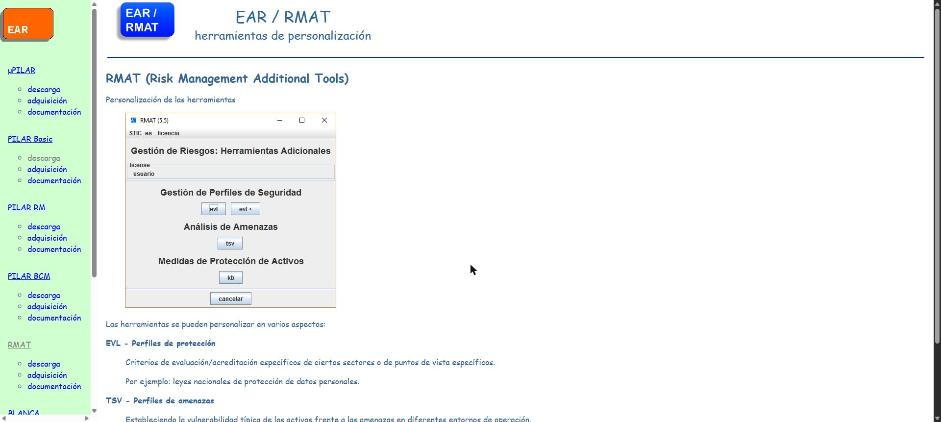

# Actividades que cubren RMAT y PILAR (G06)

La guía PRAC06 pide «en una matriz determinar actividades que se realizan con RMAT y PILAR», pero no dice qué es RMAT. La plantilla docente lo reconoce: «la práctica adjunta no precisa cuál RMAT usa» (instrucción 14).

## 1. Identificación de RMAT y limitación

| Campo | Valor |
|---|---|
| Producto | **RMAT — Risk Management Additional Tools** («Gestión de Riesgos: Herramientas Adicionales») |
| Versión | 5.5.2 (23/2/2021), según su página de descarga |
| Desarrollador | A.L.H. J. Mañas S.L., el mismo de EAR/PILAR |
| Documentación usada | https://ar-tools.com/es/tools/rmat/index.html (consultada el 2026-11-01; captura `rmat_pagina_oficial.jpg`) |
| Documentación de PILAR | Ayuda instalada `C:\Program Files (x86)\PilarBasic_2026.1\info_es\index.htm`, `README_Basic_es.txt` y el portal https://pilar.ccn-cert.cni.es/ |
| Acceso | La licencia de RMAT se entrega bajo solicitud; **no se instaló**. La comparación se hace con su documentación oficial. |

**Limitación para validación docente.** Se interpreta que RMAT es la herramienta del ecosistema EAR/PILAR, porque es la única con ese nombre ligada a MAGERIT. El acrónimo también se usa en otros ámbitos (por ejemplo, herramientas genéricas de evaluación de la gestión de riesgos), así que la identificación **no es inequívoca**. Si el docente se refería a otra herramienta, esta tabla debe rehacerse.

## 2. Matriz de actividades

| Actividad de gestión de riesgos | PILAR Basic 2026.1.1 (usado en G06) | RMAT 5.5.2 (documentación) | Qué se hizo en Cóndor |
|---|---|---|---|
| Definir el contexto y el alcance del proyecto | Sí: datos del proyecto, dominios de seguridad, fases (potencial, current, target, PILAR) | No: no gestiona proyectos | Proyecto `CONDOR.mgr`, dominio `[base]` |
| Identificar activos y dependencias | Sí: capas y clases de MAGERIT, árbol de dependencias (A.1) | No | 10 activos A01–A10 con sus dependencias |
| Valorar activos | Sí: [D] [I] [C] [A] [T] en escala 0–10, con propagación por dependencias (A.2) | Define **criterios de valoración** propios de un sector mediante perfiles **EVL** (por ejemplo, leyes nacionales de datos personales) | Valoración con criterios de MAGERIT. Un perfil EVL permitiría usar la Ley 29733 y las obligaciones de la SUNAT como criterio |
| Identificar amenazas | Asocia el catálogo de MAGERIT según la clase de cada activo (A.4) | Ajusta la **frecuencia y degradación típicas** por entorno con perfiles **TSV** | Se usó `tsv_last.xlsx` genérico. Un TSV propio reflejaría los cortes de Internet frecuentes en Majes (R07) |
| Valorar amenazas | Automática a partir del perfil TSV | Edita el perfil TSV que luego usa PILAR | Frecuencia y degradación por escenario en la matriz manual |
| Evaluar salvaguardas | Madurez actual y objetivo L0–L5 por grupo; recomendación de PILAR (A.5) | Añade **medidas de protección** específicas por tipo de activo (**KB**) | 19 grupos valorados; S1–S3 con evidencia |
| Calcular impacto y riesgo | Sí: potencial, actual, objetivo y recomendado por activo y dimensión (A.6) | **No** calcula riesgo | `03_PILAR/capturas/07` a `10` |
| Planificar el tratamiento | Fases de mejora y comparación entre ellas | No | `02_Matriz_y_Tratamiento/plan_tratamiento.md` |
| Informes | Modelo de valor, salvaguardas y gráficas (bloqueados en la licencia de evaluación) | No genera informes de riesgo | Exportación bloqueada; se usaron capturas y el `.mgr` |
| Cumplimiento normativo | Perfiles ISO 27002 (2005, 2013, 2022), 27701, GDPR, RD 1720 y otros (`bib_es/*.evl`) | Crea o adapta esos perfiles | No se pidió en G06 |
| Usuario previsto | Analista de riesgos del sistema | Consultor o equipo que mantiene la biblioteca de una organización o sector | — |

## 3. Conclusión

PILAR y RMAT no son alternativas, sino **complementos**. PILAR ejecuta el método MAGERIT sobre un sistema concreto: activos, valoración, amenazas, salvaguardas y riesgo. RMAT no analiza ningún sistema: **personaliza la biblioteca** que usa PILAR (criterios EVL, perfiles de amenaza TSV y medidas KB).

Para una ferretería con un solo sistema, PILAR con la biblioteca estándar basta. RMAT valdría la pena si muchas empresas del mismo rubro reutilizaran un perfil de amenazas propio, por ejemplo una cadena de ferreterías en zonas con cortes de luz e Internet frecuentes.
